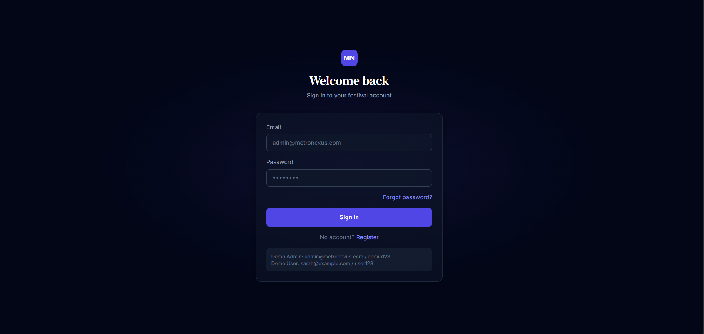
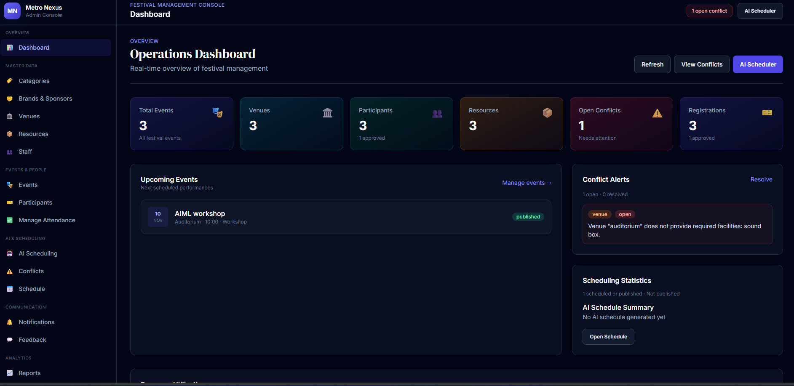
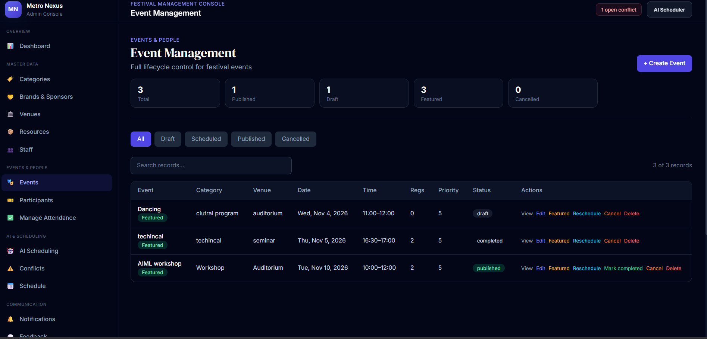
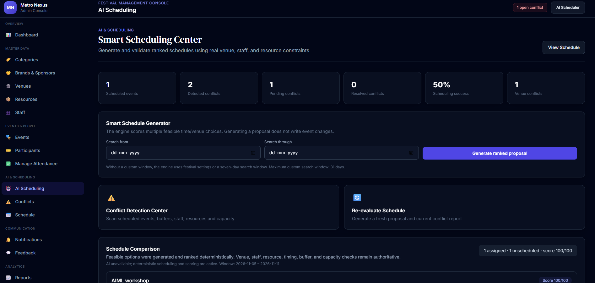
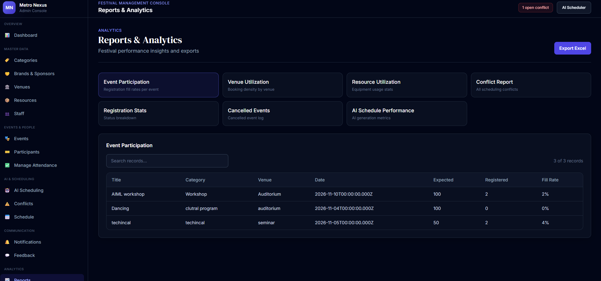

# 🚀 Metro Nexus Festival OS

### AI-Powered Event Scheduling & Conflict Resolution Platform

Metro Nexus Festival OS is a full-stack MERN web application designed to simplify the management of large-scale festivals and events. It combines AI-powered scheduling, intelligent conflict detection, event management, participant registration, and attendance tracking into a centralized platform.

The application provides dedicated Admin and Student portals to streamline event operations, reduce manual scheduling efforts, and improve resource utilization.

## 🌐 Live Demo

- **Frontend:** [Metro Nexus Festival OS](https://ai-based-event-scheduling-conflict-trbe.onrender.com)
- **Backend API:** [Backend Service](https://ai-based-event-scheduling-conflict.onrender.com)
- **API Health Check:** [Check API Status](https://ai-based-event-scheduling-conflict.onrender.com/api/health)

## 🌟 Key Features

### 1. 🔐 Authentication & Role-Based Access
- Secure user registration and login.
- Separate Admin and Student access.
- JWT-based authentication.
- Protected routes and authorization middleware.
- Password management and account security.

### 2. 🎪 Event Management
- Create, update, publish, and manage events.
- Configure event dates, time slots, venues, capacity, and resources.
- Track scheduled and completed events.
- Manage event information through the Admin Dashboard.

### 3. 🤖 AI-Powered Dynamic Scheduling
- Generate ranked scheduling proposals.
- Analyze event scheduling requirements.
- Recommend feasible scheduling arrangements.
- Assist administrators in optimizing event plans.
- Review scheduling proposals before applying them.

### 4. ⚠️ Intelligent Conflict Detection & Resolution

Detect scheduling conflicts involving:
- Venue availability.
- Staff availability.
- Resource allocation.
- Event timing overlaps.
- Venue capacity.
- Buffer-time constraints.

Identify conflicts and help administrators review and resolve scheduling issues.

### 5. 📝 Student Event Registration
- Browse available events.
- Register for events.
- View registered events.
- Track registration and event status.

### 6. ✅ Attendance Management
- Admins and organizers can mark participants as Present or Absent.
- Attendance is stored against event registrations.
- Students can view their attendance status.
- Track event completion and attendance information.

### 7. 🔔 Notification System
- Event-related notifications.
- Registration updates.
- User-specific notification management.

### 8. 📊 Role-Based Dashboards

**Admin Dashboard**
- Event management.
- AI scheduling proposals.
- Conflict monitoring.
- Registration management.
- Attendance tracking.
- Event statistics and reports.

**Student Dashboard**
- Browse available events.
- View registrations.
- Track event status.
- Check attendance.
- Receive notifications.

---

## 🛠️ Technology Stack

| Category | Technologies |
|---|---|
| Frontend | React.js, Vite, JavaScript |
| Backend | Node.js, Express.js |
| Database | MongoDB, Mongoose |
| AI Integration | OpenAI API |
| Authentication | JWT, Password Hashing |
| API Communication | REST APIs, Axios |
| Development Tools | Git, GitHub, VS Code, Postman |

---

## 🏗️ Project Architecture

```text
Metro-Nexus-Festival-OS/
│
├── client/
│   ├── src/
│   │   ├── components/
│   │   ├── pages/
│   │   ├── services/
│   │   └── ...
│   ├── package.json
│   └── vite.config.js
│
├── server/
│   ├── src/
│   │   ├── config/
│   │   ├── controllers/
│   │   ├── models/
│   │   ├── routes/
│   │   ├── middleware/
│   │   ├── services/
│   │   └── utils/
│   ├── package.json
│   └── ...
│
├── screenshots/
│   ├── login.png
│   ├── dashboard.png
│   ├── event-management.png
│   ├── ai-scheduling.png
│   └── reports.png
│
└── README.md
```

---

## ⚙️ Installation & Setup

### Prerequisites

Make sure you have installed:

- Node.js
- npm
- MongoDB Atlas account or MongoDB instance
- Git

### 1. Clone the Repository

```bash
git clone https://github.com/nidhikumari23/Ai-based-event-scheduling-conflict-resolution.git

cd Ai-based-event-scheduling-conflict-resolution
```

### 2. Install Backend Dependencies

```bash
cd server
npm install
```

### 3. Configure Backend Environment Variables

Create a `.env` file inside the `server` directory.

```env
PORT=5000
MONGO_URI=your_mongodb_connection_string
JWT_SECRET=your_jwt_secret
OPENAI_API_KEY=your_openai_api_key
```

Add any additional environment variables required by your project, such as email configuration if password reset is enabled.

**Important:** Never upload `.env` files, API keys, database credentials, or other sensitive information to GitHub.

### 4. Start the Backend Server

```bash
npm run dev
```

Backend API:

```text
http://localhost:5000
```

### 5. Install Frontend Dependencies

Open a new terminal:

```bash
cd client
npm install
```

### 6. Configure Frontend Environment

Create a `.env` file inside the `client` directory:

```env
VITE_API_URL=http://localhost:5000
```

### 7. Start the Frontend Server

```bash
npm run dev
```

Frontend:

```text
http://localhost:5173
```

---

## 🔄 Application Workflow

```text
        Admin Login
             |
             v
     Create & Manage Events
             |
             v
 Configure Venues, Staff & Resources
             |
             v
 Generate AI Scheduling Proposal
             |
             v
   Detect Scheduling Conflicts
             |
             v
    Review & Apply Schedule
             |
             v
   Students Browse & Register
             |
             v
       Event Takes Place
             |
             v
    Admin Marks Attendance
             |
             v
 Students View Attendance Status
```

---

## 📸 Project Screenshots

### 1. Login & Authentication



### 2. Admin Dashboard



### 3. Event Management



### 4. AI-Powered Dynamic Scheduling



### 5. Reports & Analytics



---

## 🔒 Security & Reliability

- JWT-based authentication.
- Role-based authorization.
- Password hashing and password reset workflows.
- Account status validation.
- Notification ownership checks.
- Protected Admin operations.
- Backend-side event and registration validation.
- Secure API response handling.

---

## 🎯 Project Objectives

- Automate complex event scheduling workflows.
- Minimize venue, staff, and resource conflicts.
- Improve festival planning efficiency.
- Simplify event registration and attendance tracking.
- Provide AI-assisted scheduling recommendations.
- Centralize festival operations through role-based dashboards.

---

## 🚀 Future Enhancements

- Advanced scheduling optimization algorithms.
- More comprehensive automated testing.
- Enhanced real-time notification workflows.
- Improved scheduling analytics and reporting.
- Performance and scalability improvements.

---

## 👩‍💻 Developed By

**Nidhi Kumari**

B.Tech – Computer Science & Engineering

GitHub: [nidhikumari23](https://github.com/nidhikumari23)

---

## ⭐ Support

If you find this project interesting, consider giving the repository a star ⭐ on GitHub.

**Metro Nexus Festival OS – Smarter Scheduling. Seamless Events.**